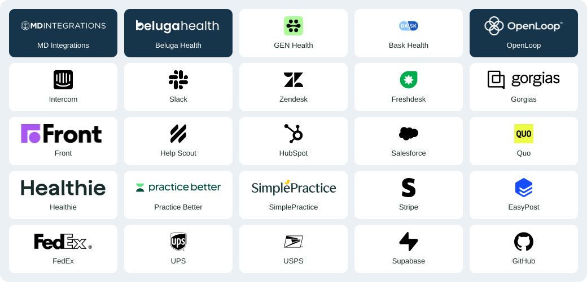

# Summer MCP: connect AI to your telehealth tools

[Summer](https://gosummer.ai) is AI customer support for telehealth companies. Connect your help desk, clinical platforms, pharmacies and billing tools so your team can investigate order delays, answer billing questions and follow a case through to its next step.

Use Summer's hosted Model Context Protocol (MCP) server from Claude, Codex, Cursor or another compatible AI client. Your agent can set up connections, read support cases, request investigations and prepare actions for human approval in Summer.

[Book a demo](https://gosummer.ai/book) · [Connect your AI assistant](#connect-your-ai-assistant) · [Explore integrations](#connect-the-tools-your-team-already-uses) · [Read the telehealth integration guides](#telehealth-ai-integration-guides)

## Built for the work behind a telehealth support ticket

A customer asks, "Where is my order?" The answer may sit across a help desk conversation, a paid purchase, a clinical review, a pharmacy portal and a carrier scan. Summer brings that evidence into one case so your team can see what happened and decide what to do next.

- Keep the tools your team knows. Connect the systems you already use and check the workflows your accounts support.
- Spend less time reconstructing the story. Review the original customer request, prior promises, current records and investigation together.
- Give customers a useful answer. Explain the actual delay or charge, with evidence behind the proposed next step.
- Keep people in control. Review exact messages and business changes before approving them in Summer. Hand clinical questions to the care team.
- Keep company knowledge current. Edit policies and publish help articles with revision history; use the same knowledge for support and Messenger.

[See telehealth support workflows](https://gosummer.ai/blog/telehealth-ai-support-use-cases) or bring a representative case to [a demo](https://gosummer.ai/book) to confirm the supported scope for your business.

## Connect the tools your team already uses

Summer connects services through authorized APIs, Slack authorization and supported browser workflows. A vendor does not need its own MCP server: your AI assistant connects to Summer, and Summer investigates through your company's configured services.

The directory below covers the services in [Summer's connection guides](https://gosummer.ai/docs/service-connections). Built-in credential setup is available for eight services. Other connections need the account access and workflow shown below, followed by verification against a known record.

[](https://gosummer.ai/docs/service-connections)

### Help desks, CRM and team conversations

| Service | Connection method | Useful support work |
| --- | --- | --- |
| [Intercom](https://gosummer.ai/docs/help-desk-connections#intercom) | Built-in credential setup | Read customer conversations and attachments for a support investigation. |
| [Slack](https://gosummer.ai/docs/slack) | Workspace authorization | Read selected channels and retain vendor discussions with the case. Approved replies require channel permission. |
| [Zendesk](https://gosummer.ai/docs/help-desk-connections#zendesk) | Custom connection | Check tickets and customer history through the agreed API or permitted browser workflow. |
| [Freshdesk](https://gosummer.ai/docs/help-desk-connections#freshdesk) | Custom connection | Bring the relevant inbox conversation into an investigation. |
| [Gorgias](https://gosummer.ai/docs/help-desk-connections#gorgias) | Custom connection | Connect customer messages to the purchase and support issue. |
| [Front](https://gosummer.ai/docs/help-desk-connections#front) | Custom connection | Check shared-inbox history and prior follow-ups. |
| [Help Scout](https://gosummer.ai/docs/help-desk-connections#help-scout) | Custom connection | Read the customer conversation and existing support commitments. |
| [HubSpot](https://gosummer.ai/docs/help-desk-connections#hubspot) | Custom connection | Use the CRM records required for the agreed support workflow. |
| [Salesforce](https://gosummer.ai/docs/help-desk-connections#salesforce) | Custom connection | Match permitted CRM records and support cases. |

### Clinical platforms, EHRs and pharmacies

| Service | Connection method | Useful support work |
| --- | --- | --- |
| [MD Integrations (MDI)](https://gosummer.ai/docs/clinical-pharmacy-connections#md-integrations) | Built-in credential setup | Match the customer case to the correct administrative care records. |
| [Beluga Health](https://gosummer.ai/docs/clinical-pharmacy-connections#beluga-health) | Built-in credential setup | Check visit, pharmacy and fulfillment evidence available to your account. |
| [GEN Health](https://gosummer.ai/docs/clinical-pharmacy-connections#gen-health) | Built-in credential setup | Read authorized order and care records for the support case. |
| [Bask Health](https://gosummer.ai/docs/clinical-pharmacy-connections#bask-health) | Custom connection | Scope the clinical-platform records and workflows your account exposes. |
| [OpenLoop](https://gosummer.ai/docs/clinical-pharmacy-connections#openloop) | Custom connection | Connect available administrative platform evidence to customer support. |
| [Healthie](https://gosummer.ai/docs/clinical-pharmacy-connections#healthie) | Custom connection | Read the permitted health-record context needed for support logistics. |
| [Practice Better](https://gosummer.ai/docs/clinical-pharmacy-connections#practice-better) | Custom connection | Check the practice records available under your authorized access. |
| [SimplePractice](https://gosummer.ai/docs/clinical-pharmacy-connections#simplepractice) | Custom connection | Arrange access to the records needed for your support workflow. |
| [Strive Pharmacy](https://gosummer.ai/docs/clinical-pharmacy-connections#strive-pharmacy) | Partner portal workflow | Check the exact pharmacy order, current updates and prior support inquiries. |
| [Empower Pharmacy](https://gosummer.ai/docs/clinical-pharmacy-connections#empower-pharmacy) | Custom connection | Confirm partner access and arrange the required API or permitted portal workflow. |
| [The Pharmacy Hub](https://gosummer.ai/docs/clinical-pharmacy-connections#the-pharmacy-hub) | Custom connection | Match pharmacy references and verify the support records your account can read. |

### Billing, shipping, phone and business records

| Service | Connection method | Useful support work |
| --- | --- | --- |
| [Stripe](https://gosummer.ai/docs/service-connections#stripe) | Built-in credential setup | Read payment and subscription evidence. Supported refunds and subscription changes need exact human approval. |
| [EasyPost](https://gosummer.ai/docs/service-connections#shipping-and-carriers) | Built-in credential setup | Match shipment tracking and carrier events to the customer's purchase. |
| [FedEx](https://gosummer.ai/docs/service-connections#shipping-and-carriers) | Carrier evidence | Read tracking through EasyPost or an agreed carrier workflow. |
| [UPS](https://gosummer.ai/docs/service-connections#shipping-and-carriers) | Carrier evidence | Check pickup and delivery events through the configured tracking source. |
| [USPS](https://gosummer.ai/docs/service-connections#shipping-and-carriers) | Carrier evidence | Check the latest recorded tracking event for the matching order. |
| [Quo](https://gosummer.ai/docs/service-connections#quo) | Built-in credential setup | Connect phone and text records; sending and call routing need their own configured workflow. |
| [Supabase](https://gosummer.ai/docs/service-connections#supabase) | Built-in credential setup | Read the operational database records your administrator authorizes. |
| [GitHub](https://gosummer.ai/docs/service-connections#github) | Custom connection | Carry a customer-reported software problem into the agreed engineering handoff. |

Carrier evidence does not imply a separate direct connector for each carrier. Custom connections need an agreed, verified workflow; saving credentials alone does not enable one. Your AI client uses Summer's tools and cases, rather than receiving unrestricted access to every vendor API. Vendor names and logos identify services, not endorsements.

Have another tool in your stack? Start with the [custom integration guide](https://gosummer.ai/docs/custom-integrations) or [discuss your workflow with Summer](https://gosummer.ai/book).

## What can Summer help your team do?

| Customer need | How Summer helps |
| --- | --- |
| "I paid last week. Where is my order?" | Read the conversation, matching purchase, care record, pharmacy update and carrier evidence. Show the unfinished step and proposed follow-up. |
| "I canceled. Why was I charged again?" | Compare the cancellation request with the subscription, payment, matching order and company policy. Prepare supported corrections for approval. |
| "The pharmacy needs someone to contact them." | Read the current order and previous inquiries, then propose a specific follow-up with a visible owner. |
| "How do I find my visit or reach support?" | Use Summer Messenger, shared company knowledge and published help articles for routine questions and verified customer account links. |
| "The portal link opens an error." | Keep the original report and evidence with the engineering handoff, then track the checked repair back to the case. |

Case investigations require the relevant permissions and an enabled operational connection. People approve business changes in Summer; clinical questions and treatment decisions belong with the care team. Confirm current capabilities for your company before rollout.

## Connect your AI assistant

Use hosted Summer without cloning this repository or running a server.

- Hosted endpoint: `https://api.gosummer.ai/mcp`
- Transport: Streamable HTTP
- Sign-in: Summer OAuth, with companies, environments and permissions you choose

### Claude Code

```sh
claude mcp add --transport http summer https://api.gosummer.ai/mcp
```

Run `/mcp`, choose Summer and authenticate in your browser.

### Codex

```sh
codex mcp add summer --url https://api.gosummer.ai/mcp
codex mcp login summer
```

### Cursor

Add this to your MCP configuration, then connect in Cursor's MCP settings:

```json
{
  "mcpServers": {
    "summer": { "url": "https://api.gosummer.ai/mcp" }
  }
}
```

Other clients need remote MCP over Streamable HTTP and OAuth. See the [client guide](https://gosummer.ai/docs/mcp-clients) for permissions and your first task.

### A useful first task

> Check my Summer connection and show the companies I can access. For the company and environment I choose, check our existing integrations and explain what is ready for order-delay investigations across our help desk, care platform, pharmacy and billing system. Show any missing access or verification before making changes.

For agents, start with `summer_account_me`, then `summer_company_capabilities` and `summer_integrations_list` for the selected company and environment. Read the [tool reference](docs/tools.md) for exact schemas and permissions. Keep secret values in Summer's secure credential editor or the trusted local CLI handoff.

### More prompts to try

> Read case CASE_ID. What did the customer ask for, what has already been done and what remains unresolved?

> Ask Summer to investigate the delayed order in case CASE_ID. Explain the original evidence behind the delay and the next useful step.

> Review the latest saved plan for case CASE_ID and prepare its exact changes for approval in Summer.

> Help me connect Intercom, MD Integrations and Stripe to Summer. Check the existing setup and explain what still needs verification.

Replace CASE_ID with a case your connection can access. To add customer support to your website, use the [Messenger agent setup guide](https://gosummer.ai/docs/agent-setup).

## Telehealth AI integration guides

Summer's blog covers the integration choices and operating work behind AI customer support. These guides help founders scope an implementation and give agents vendor-specific context to read before planning a connection.

### Connect AI to clinical platforms and pharmacies

| Your system | MCP and integration guide | Support workflow guide |
| --- | --- | --- |
| MD Integrations | [MD Integrations MCP: connecting AI to your telehealth stack](https://gosummer.ai/blog/md-integrations-mcp) | [Automate customer support with MD Integrations](https://gosummer.ai/blog/automate-md-integrations-support) |
| Beluga Health | [Beluga Health MCP: options for AI integration](https://gosummer.ai/blog/beluga-health-mcp) | [Beluga Health support: orders, billing and follow-ups](https://gosummer.ai/blog/beluga-health-customer-support) |
| Bask Health | [Bask Health MCP: connecting AI to your telehealth stack](https://gosummer.ai/blog/bask-health-mcp) | [Automate customer support with Bask Health](https://gosummer.ai/blog/bask-health-support-automation) |
| OpenLoop | [OpenLoop AI support vs Summer](https://gosummer.ai/blog/openloop-ai-support-vs-summer) | [MD Integrations vs Beluga vs OpenLoop vs Bask](https://gosummer.ai/blog/mdi-beluga-openloop-bask-comparison) |
| Strive Pharmacy | [Strive Pharmacy MCP: AI integration options](https://gosummer.ai/blog/strive-pharmacy-mcp) | [Automate Strive Pharmacy order follow-ups](https://gosummer.ai/blog/automate-strive-pharmacy-follow-ups) |
| Empower Pharmacy | [Empower Pharmacy MCP: AI integration options](https://gosummer.ai/blog/empower-pharmacy-mcp) | [Automate Empower Pharmacy order follow-ups](https://gosummer.ai/blog/automate-empower-pharmacy-follow-ups) |
| The Pharmacy Hub | [The Pharmacy Hub MCP: AI integration options](https://gosummer.ai/blog/pharmacy-hub-mcp) | [AI support for brands using The Pharmacy Hub](https://gosummer.ai/blog/pharmacy-hub-ai-support) |

### Plan the connection and support workflow

An API supplies permitted records or operations. MCP gives compatible agents a shared interface to tools. A supported browser workflow can supply portal evidence when the required API access is unavailable. The useful test is whether the workflow matches the right purchase, reads the necessary sources and leaves the team with a supported next step.

- [MCP for telehealth: from API access to patient support](https://gosummer.ai/blog/telehealth-mcp)
- [Connecting AI to your EHR, help desk and pharmacy](https://gosummer.ai/blog/telehealth-ai-integrations)
- [Pharmacy API, MCP or browser automation: which fits your workflow?](https://gosummer.ai/blog/pharmacy-api-mcp-browser-automation)
- [AI agent skills for telehealth support](https://gosummer.ai/blog/telehealth-ai-agent-skills)
- [Connect telehealth provider updates to your help desk](https://gosummer.ai/blog/provider-updates-help-desk)
- [Coordinate support across multiple pharmacies with AI](https://gosummer.ai/blog/multi-pharmacy-support-automation)
- [Automate "Where is my order?" for telehealth](https://gosummer.ai/blog/automate-telehealth-order-status)
- [AI pharmacy calls: investigate order delays and missing updates](https://gosummer.ai/blog/ai-pharmacy-calls)
- [AI customer support for telehealth: what can you automate?](https://gosummer.ai/blog/telehealth-ai-support-use-cases)

### Compare platforms, costs and results

Compare providers using the same support cases. Measure correct answers, verified outcomes, repeat contacts and the human work remaining. A successful tool call or a sent reply alone does not establish that the customer's issue is resolved.

- [Best AI customer support platforms for telehealth](https://gosummer.ai/blog/best-ai-support-telehealth)
- [Building a telehealth support agent: DIY vs Summer](https://gosummer.ai/blog/build-vs-buy-telehealth-support-agent)
- [Summer vs Intercom Fin for telehealth support](https://gosummer.ai/blog/summer-vs-intercom-fin)
- [Summer vs Lorikeet for telehealth customer support](https://gosummer.ai/blog/summer-vs-lorikeet)
- [AI voice agent vs telehealth support agent: what to buy](https://gosummer.ai/blog/ai-voice-vs-telehealth-support-agent)
- [How much does AI customer support cost for telehealth?](https://gosummer.ai/blog/telehealth-ai-support-cost)
- [Measure whether AI actually resolves support tickets](https://gosummer.ai/blog/measure-ai-support-resolution)

[Browse all Summer articles](https://gosummer.ai/blog).

## Questions telehealth founders ask

### Do my vendors need their own MCP servers?

No. Your AI client connects to Summer MCP. Summer uses the authorized APIs and supported browser workflows configured for your company. The vendor guides above explain access options; an article about a vendor's MCP options does not establish an official vendor-operated MCP server.

### Can we keep our existing help desk and clinical platforms?

Yes. Start with your current tools and one recurring support problem. Confirm the available connections and permissions, then compare Summer's findings with a known case before expanding the workflow.

### Should we build our own telehealth MCP server?

A custom build can fit a narrow workflow your engineers can maintain. Summer provides a hosted connection alongside a support workspace for investigations, knowledge, review and follow-through. Compare the ongoing work of maintaining connectors, recovering access and reviewing cases in the [build vs buy guide](https://gosummer.ai/blog/build-vs-buy-telehealth-support-agent).

### Can the agent send refunds or change a patient's treatment?

Supported refunds, subscription changes and other business actions require exact human approval in Summer. Clinical decisions and medication directions stay with the care team.

## Start with one case your team handles every week

Bring your help desk, clinical platform, pharmacy partners and a synthetic or redacted support example. We can confirm the available connections, review the investigation and identify the steps that still need your team.

[Book a Summer demo](https://gosummer.ai/book) · [Read the setup guide](https://gosummer.ai/docs/agent-setup) · [Browse the API reference](https://gosummer.ai/docs/api-reference)

## What is in this repository?

This is the source for Summer's MCP transport and shared operation contract. The Summer application uses this package with its own backend adapter.

- The official MCP SDK handles the protocol, discovery and result encoding.
- The operation catalog defines tool names, schemas, permission requirements and descriptions. [Browse the tool reference](docs/tools.md).
- The host supplies live authentication, permission enforcement, rate limits and operation execution through [`McpBackend`](src/backend.ts).
- Secret-moving operations return local CLI handoffs. Secret values are not MCP arguments or results.
- Static discovery is public. Tool calls, private resources and rendered setup prompts require authentication. Invalid supplied tokens cannot fall back to anonymous discovery.

The hosted service includes private storage and operational services that are not distributed here. The synthetic example below exercises the transport; it does not run a complete Summer support workspace. Features in source can precede a hosted release. Check your company's capabilities for current availability.

## Build and test the source

Requires Node.js 22.18 or newer.

```sh
npm ci --ignore-scripts
npm run check
npm run demo
```

The demo listens only on `127.0.0.1:3434`. It uses synthetic records and the literal test header `Authorization: Bearer demo-only`. It has no production credentials and cannot access Summer. It implements a few reads and refuses unsupported operations. The real hosted service uses Summer OAuth.

[`examples/demo-backend`](examples/demo-backend) shows how a host supplies the backend. Your integration must enforce current permissions and ownership in its executor; this interface does not replace those checks. See [architecture and host responsibilities](docs/architecture.md).

This repository publishes source on GitHub. It does not currently publish `@gosummerai/mcp` to npm. The separate [Summer CLI](https://www.npmjs.com/package/@gosummerai/cli) handles local setup and secret transfer.

## Maintenance and contributions

Summer maintains this package in its private development repository and exports reviewed files here after passing release checks. This repository has clean public history; it does not include private application history.

Issues and pull requests are welcome. Accepted changes are integrated into the source repository, tested with Summer and then exported here. See [CONTRIBUTING.md](CONTRIBUTING.md). The code is available under the [MIT license](LICENSE).

### Client freshness

Normal tool calls return their original business data plus
`_meta["ai.gosummer/client-status"]`. Update and refresh warnings also appear as
additional text content, so the agent sees them without a separate status call.
These advisories never turn a successful call into an error or repeat an effect.
Clients may report `cli_version`, cached `mcp_version` and `last_checked_at` in
request `_meta["ai.gosummer/client"]`, or through `Summer-CLI-Version`,
`Summer-MCP-Version` and `Summer-Last-Checked-At` headers. Known Summer CLI
User-Agent versions are recognized too. Missing or malformed diagnostics are
treated as unknown; they never block the business request. Generic client app
versions are not compared with the Summer CLI version.

The hosted server reports its live catalog version during initialization. Its
ordinary responses flag an unknown or week-old check without blocking work. A
separate diagnostic check is useful after an unknown tool or schema mismatch. Use
`summer_client_status` with `cli_version`, cached `mcp_version` and
`last_checked_at` for structured warnings. A stale check does not prove an obsolete
version. The server cannot inspect local installations or cached tool lists.
Known old Summer CLI versions also receive a warning in initialization instructions.
Refresh initialization and `tools/list` when catalog versions differ. Check CLI npm
releases with `summer version --check --json`. Software updates never grant scopes
or approve effects; reconnect through normal Summer consent when required.
